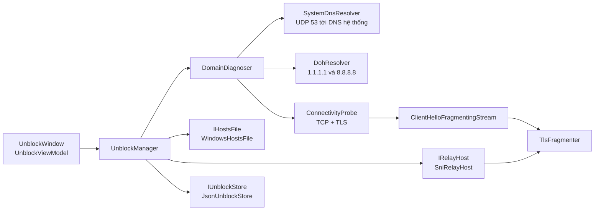
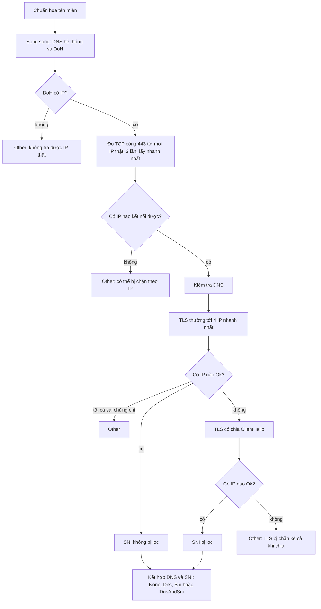
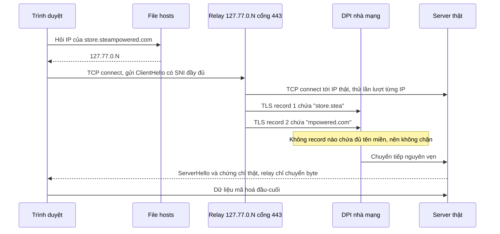

# Mở chặn tên miền (Unblock domains)

Tài liệu mô tả tính năng **Unblock domains** của LeaveMeAlone: nó giải quyết vấn đề gì,
hoạt động ra sao, mỗi thành phần nằm ở đâu trong code, và những giới hạn cần biết.

- Mã nguồn: `src/LeaveMeAlone/Services/Unblock/`
- Giao diện: `src/LeaveMeAlone/Views/UnblockWindow.xaml(.cs)`, `UnblockViewModels.cs`
- Test: `tests/LeaveMeAlone.Tests/Unblock/`

---

## 1. Bối cảnh

Một số nhà mạng (ví dụ ở Việt Nam) chặn các tên miền như `store.steampowered.com` hay
`steamcommunity.com`. Nhà mạng **không** chặn đường mạng tới server. Họ chỉ lọc ở hai điểm:

| Cơ chế | Cách hoạt động | Dấu hiệu |
|---|---|---|
| **DNS poisoning** | DNS của nhà mạng trả về địa chỉ giả (thường là `127.0.0.1`) | Tra DNS hệ thống ra IP vô nghĩa, tra qua DoH ra IP thật |
| **SNI filtering** | Thiết bị DPI đọc tên miền trong gói TLS ClientHello (trường SNI, chưa mã hoá) rồi reset kết nối | Kết nối TCP tới IP thật vẫn được, nhưng TLS bị reset ngay khi gửi đúng tên miền |

Hai cơ chế có thể xuất hiện riêng lẻ hoặc cùng lúc. Dùng VPN thì vượt được cả hai, nhưng chậm,
tốn phí và kéo theo toàn bộ traffic không liên quan. Tính năng này chỉ né đúng hai điểm lọc trên,
**chỉ cho những tên miền người dùng chọn**, và traffic vẫn đi thẳng tới server thật.

### Kết quả đo thực tế (2026-10-04, mạng gia đình ở Việt Nam)

| Thử nghiệm | Kết quả |
|---|---|
| DNS hệ thống cho `store.steampowered.com` | `127.0.0.1` (bị đầu độc) |
| DoH `1.1.1.1` cho cùng tên miền | `104.83.198.104` (IP thật) |
| TLS tới `104.83.198.104`, SNI = `store.steampowered.com` | **reset** |
| TLS tới cùng IP, SNI = `example.org` | handshake xong (chỉ sai chứng chỉ) → chứng tỏ bị lọc theo SNI |
| Chia ClientHello thành **nhiều gói TCP** | **vẫn bị reset** (DPI ghép lại luồng TCP) |
| Chia ClientHello thành **2 TLS record** | **HTTP 200**, tải đủ trang Steam 1.2 MB |
| IP Akamai đặt trong nước (`42.119.x`, ~3 ms) | TLS bình thường vẫn thành công, không bị lọc SNI |

Kết luận: chỉ cần (1) dùng IP thật thay cho câu trả lời DNS bị đầu độc và (2) chia ClientHello
ở **tầng TLS record**. Không cần VPN, proxy bên ngoài hay driver bắt gói tin (WinDivert).

---

## 2. Người dùng làm được gì

Mở bằng nút **Unblock domains** ở header cửa sổ chính.

| Thao tác | Ý nghĩa |
|---|---|
| **Diagnose** (hoặc Enter) | Cho biết tên miền đang bình thường, bị chặn DNS, bị chặn SNI, bị cả hai, hay bị chặn kiểu khác. Không cần quyền admin. |
| Bảng **Real IPs, fastest first** | Các IP thật xếp theo độ trễ TCP, kèm kết quả TLS của từng IP (xanh = dùng được). |
| **Unblock** | App tự chọn cách mở phù hợp với kiểu chặn vừa phát hiện. |
| **Quick: Steam** | Chẩn đoán 11 tên miền của Steam, chỉ mở những tên miền thật sự bị chặn. |
| Danh sách **Unblocked now** | Tên miền nào đang mở, bằng cách nào (`DNS PIN` / `SNI RELAY`), qua IP nào, relay còn chạy không. |
| **Remove** / **Remove all** | Gỡ một hoặc tất cả; trả hệ thống về như cũ. |

Đầu vào chấp nhận cả URL (`https://Store.SteamPowered.com/app/570`) và tên miền quốc tế (IDN).
App chuẩn hoá thành tên miền ASCII viết thường (`DomainName.Normalize`).

---

## 3. Kiến trúc



| File | Vai trò |
|---|---|
| `UnblockModels.cs` | `BlockKind`, `UnblockMethod`, `TlsOutcome`, `AddressProbe`, `DomainDiagnosis`, `UnblockedDomain`, `DomainName`, `UnblockException` |
| `DnsWire.cs` | Tự dựng/đọc gói DNS (RFC 1035) cho truy vấn A; `AddressClassifier.IsBogon` |
| `Resolvers.cs` | `SystemDnsResolver` (hỏi thẳng DNS server của card mạng) và `DohResolver` (DNS-over-HTTPS) |
| `ConnectivityProbe.cs` | Đo thời gian kết nối TCP; thử TLS handshake thường hoặc có chia ClientHello |
| `TlsFragmenter.cs` | Chia một TLS record ClientHello thành 2 record, cắt giữa tên miền |
| `DomainDiagnoser.cs` | Phân loại kiểu chặn + xếp hạng IP |
| `HostsFile.cs` | `HostsBlock` (thao tác văn bản thuần) + `WindowsHostsFile` (đọc/ghi file thật, flush DNS) |
| `SniRelay.cs` | Relay TCP trên loopback cho các tên miền bị lọc SNI |
| `UnblockManager.cs` | Điều phối relay → hosts → lưu trữ, có rollback |
| `UnblockStore.cs` | Lưu `%APPDATA%\LeaveMeAlone\unblocked.json` |
| `UnblockPresets.cs` | Danh sách tên miền cho nút Quick: Steam |

Các thành phần được ghép trong `App.xaml.cs` (composition root), giống phần bundle tường lửa.
`UnblockManager` chỉ phụ thuộc vào interface nên được unit test bằng fake.

---

## 4. Chẩn đoán (`DomainDiagnoser`)



### 4.1. Phát hiện DNS poisoning

1. **DNS hệ thống** được hỏi bằng gói UDP tự dựng (`DnsWire`) gửi thẳng tới các DNS server
   cấu hình trên card mạng. App **không** dùng `Dns.GetHostAddressesAsync`, vì hàm đó đọc file
   hosts và sẽ trả về chính các IP app đã ghi vào, che mất câu trả lời thật của nhà mạng.
2. **IP thật** lấy qua DoH tới `https://1.1.1.1/dns-query` và `https://8.8.8.8/resolve`, rồi
   **gộp** kết quả hai bên. Dùng IP thay cho tên miền nên bản thân bước tra cứu không thể bị đầu
   độc DNS. Gộp kết quả vì mỗi bên biết các edge CDN khác nhau; trên thực tế Google trả về edge
   Akamai trong nước còn Cloudflare thì không.
3. Kết luận **bị đầu độc** khi:
   - DNS hệ thống không trả lời được, nhưng DoH thì có; hoặc
   - DNS hệ thống trả về **bogon**: `127/8`, `0/8`, `10/8`, `172.16/12`, `192.168/16`,
     `169.254/16`, `100.64/10`, multicast, cùng loopback/link-local/ULA của IPv6; hoặc
   - IP của DNS hệ thống khác hoàn toàn IP của DoH **và** TLS tới IP đó trả về sai chứng chỉ hoặc
     không kết nối được.

   Chỉ "khác IP" thôi thì **chưa** kết luận là bị đầu độc, vì CDN trả IP khác nhau tuỳ resolver.

### 4.2. Xếp hạng IP

Mỗi IP thật được thử kết nối TCP tới cổng 443 hai lần (timeout 4 giây), lấy lần nhanh hơn. IP
không kết nối được xếp cuối. Chỉ **4 IP nhanh nhất** (`TlsCheckedAddresses`) được kiểm tra TLS,
các IP còn lại hiển thị `not tested`.

### 4.3. Phát hiện SNI filtering

`ConnectivityProbe.TlsHandshakeAsync` thực hiện một TLS handshake thật bằng `SslStream`, với
SNI là tên miền cần kiểm tra. Probe không từ chối chứng chỉ mà ghi nhận lỗi để phân loại:

| `TlsOutcome` | Ý nghĩa |
|---|---|
| `Ok` | Handshake xong, chứng chỉ khớp tên miền |
| `CertificateMismatch` | Handshake xong nhưng IP này không phục vụ tên miền đó |
| `Reset` | Kết nối bị đóng/reset giữa chừng; đặc trưng của SNI filtering |
| `Timeout` / `ConnectFailed` | Như tên gọi |

- Mọi IP được thử đều `Ok` → SNI không bị lọc.
- **Một số** IP `Ok` → vẫn coi là không bị lọc, chỉ dùng các IP `Ok`. Trường hợp này hay gặp
  với CDN: edge trong nước thì qua, edge quốc tế thì bị lọc. Phần mô tả chẩn đoán sẽ nói rõ điều đó.
- Không IP nào `Ok` → thử lại với ClientHello bị chia. Nếu qua được thì kết luận **SNI filtering**.

### 4.4. Kết quả

`DomainDiagnosis` gồm `Kind`, IP từ DNS hệ thống, IP thật, danh sách đã xếp hạng (`Ranked`) và
`Detail` (giải thích bằng chữ). `UsableAddresses` là các IP kết nối được và TLS `Ok` (với cách
mà phương pháp mở chặn sẽ dùng), xếp từ nhanh đến chậm.

---

## 5. Mở chặn

`UnblockManager.UnblockAsync` chọn phương pháp theo kiểu chặn phát hiện được:

| `BlockKind` | Phương pháp | Ghi vào hosts |
|---|---|---|
| `None` | Từ chối ("không bị chặn") | — |
| `Dns` | `HostsPin` | Tối đa 4 IP dùng được: `42.119.186.138 store.steampowered.com` |
| `Sni` / `DnsAndSni` | `SniRelay` | `127.77.0.N store.steampowered.com` |
| `Other` | Từ chối, kèm lý do | — |

Trước khi ghi, app kiểm tra file hosts **ngoài** khối của app đã có dòng nào cho tên miền này
chưa (`HostsBlock.HasForeignEntry`). Nếu có thì app từ chối, để không ghi đè hay xung đột với
cấu hình riêng của người dùng.

### 5.1. Hosts pin (chặn DNS)

Windows đọc file hosts trước khi hỏi DNS, nên ghi IP thật vào hosts là vượt được DNS poisoning.
Ghi nhiều dòng cho cùng một tên miền thì trình duyệt có IP dự phòng. Cách này **vẫn hoạt động khi
app đã đóng**.

### 5.2. SNI relay



- Mỗi tên miền có một địa chỉ loopback riêng (`127.77.0.1`, `.2`, …; cả dải `127/8` đều là
  loopback trên Windows). Nhờ vậy relay biết đích đến mà không cần đọc SNI. App giữ nguyên địa
  chỉ cũ khi mở lại cùng tên miền.
- Relay nghe cổng **443**, đọc **đúng một TLS record** đầu tiên (tối đa 64 KB, timeout 10 giây),
  chia nó bằng `TlsFragmenter`, gửi từng phần riêng (`NoDelay` + flush), rồi chuyển tiếp hai chiều
  không sửa gì thêm. Dữ liệu không phải TLS handshake thì được chuyển nguyên vẹn.
- Cổng **80** được relay nguyên trạng để chuyển hướng HTTP → HTTPS vẫn chạy. Nếu không mở được
  cổng 80 (ví dụ IIS/http.sys đang giữ) thì bỏ qua và ghi vào `LastError`.
- **Không phải proxy giải mã.** Relay không có khoá, không cài chứng chỉ. Trình duyệt vẫn bắt tay
  TLS trực tiếp với server thật và tự kiểm tra chứng chỉ của server.
- Kết nối tới upstream thử lần lượt các IP đã lưu (timeout 5 giây mỗi IP), nên có dự phòng khi
  một edge bị lỗi.

### 5.3. Cách chia ClientHello (`TlsFragmenter`)

Một TLS record có header 5 byte: `type(0x16) | version(2) | length(2)`. App:

1. Tìm tên miền trong payload và chọn điểm cắt ở **giữa tên miền**. Nếu không tìm thấy thì cắt
   ngay sau byte đầu tiên, để record đầu không thể được nhận dạng là ClientHello.
2. Tạo hai record cùng version với record gốc, mỗi record chứa một nửa payload.
3. Giữ nguyên phần byte thừa phía sau record (nếu có).

RFC 8446 §5.1 cho phép một handshake message trải trên nhiều record, nên server ghép lại bình
thường. DPI chỉ xét từng record thì không bao giờ thấy đủ tên miền. Test tích hợp cho thấy chính
bộ đọc SNI phía server của .NET cũng đọc sai tên trong trường hợp này (nó chỉ xét record đầu),
trong khi SChannel vẫn hoàn tất handshake. Đó đúng là điểm mù mà DPI của nhà mạng gặp phải.

---

## 6. File hosts: thay đổi và gỡ sạch

App chỉ sở hữu **một khối có đánh dấu**. Dòng đánh dấu cố ý giữ tên cũ của app
(`FirewallBundleBlocker`) để các bản cài cũ vẫn tìm và gỡ được khối của mình:

```
# >>> FirewallBundleBlocker unblock (managed by the app - do not edit) >>>
42.119.186.138 store.steampowered.com
127.77.0.2 steamcommunity.com
# <<< FirewallBundleBlocker unblock <<<
```

Cam kết **gỡ ra thì khôi phục đúng từng byte** (`HostsBlock`):

- Mọi thứ ngoài khối được giữ nguyên. Khi cập nhật, khối được thay **tại chỗ**, không dời xuống
  cuối file.
- Nếu file gốc không có dòng trống cuối, app phải chèn thêm một dấu xuống dòng. Khi đó app gắn
  cờ ` +nl` vào dòng mở khối, để lúc gỡ biết mà xoá luôn dấu xuống dòng đã chèn.
- Giữ nguyên kiểu xuống dòng của file (`\r\n` hoặc `\n`).
- `WindowsHostsFile` đọc/ghi bằng Latin-1 (hoặc UTF-8 nếu file có BOM) nên mọi byte đi qua
  nguyên vẹn. App ghi đè nội dung trên chính file đó để giữ ACL và thuộc tính.
- Trước mỗi lần ghi, bản cũ được sao lưu vào `%APPDATA%\LeaveMeAlone\hosts.backup`.
- Sau khi ghi, app chạy `ipconfig /flushdns` để thay đổi có hiệu lực ngay.
- Nếu nội dung không đổi thì app không ghi, nên không cần quyền admin và không flush DNS vô ích.

### Thứ tự ghi và rollback (`UnblockManager.CommitAsync`)

```
dừng relay cũ (nếu có) → khởi động relay mới → ghi hosts → lưu unblocked.json
```

- Khởi động relay hoặc ghi hosts lỗi → dừng relay mới, khởi động lại relay cũ, báo lỗi. Hosts
  và danh sách không đổi.
- Lưu JSON lỗi → ghi lại khối hosts theo trạng thái cũ, rồi báo lỗi.

### Vòng đời theo app

| Thời điểm | Hành động |
|---|---|
| Mở app | `InitializeAsync`: đọc `unblocked.json`, khởi động relay, ghi lại khối hosts. Relay nào không khởi động được (ví dụ cổng 443 đang bận) sẽ bị **bỏ khỏi hosts** và báo cảnh báo lên thanh trạng thái. |
| Thoát app | `ShutdownAsync`: dừng mọi relay, **xoá các dòng relay khỏi hosts** (giữ lại hosts pin). Nếu không, các tên miền đó sẽ trỏ vào một địa chỉ loopback không còn ai nghe. |
| App bị crash | Các dòng relay còn sót trong hosts sẽ được sửa ở lần mở app tiếp theo, hoặc gỡ bằng **Remove all**. |
| Remove all | Dừng mọi relay, xoá cả khối khỏi hosts, xoá danh sách đã lưu. |

---

## 7. Quyền admin và báo lỗi

- **Diagnose** không cần quyền admin. **Unblock / Remove / Remove all** cần quyền admin vì phải ghi
  file hosts. Khi app chạy không có quyền admin, các nút này bị tắt. Nếu vẫn gọi được thì app báo:
  *"administrator rights are required to edit the hosts file. Restart the app and accept the UAC
  prompt."*
- Gặp `UnauthorizedAccessException` khi ghi hosts → báo rõ cần quyền admin, đồng thời nhắc kiểm
  tra thuộc tính read-only hoặc antivirus đang khoá file.
- Mọi lỗi đều hiện ở thanh trạng thái của cửa sổ (`GuardedViewModel.RunGuardedAsync`). Lỗi khi
  khôi phục lúc mở app được đẩy lên thanh trạng thái của cửa sổ chính.

---

## 8. Quyền riêng tư

- Dịch vụ bên ngoài duy nhất được gọi là **DoH của Cloudflare (`1.1.1.1`) và Google (`8.8.8.8`)**,
  và chỉ để tra IP thật. Dữ liệu gửi đi chỉ có **tên miền** cần tra.
- Không có VPN, proxy hay server trung gian nào. Traffic đi thẳng từ máy tới server đích.
- Relay chỉ nghe trên loopback, nên các máy khác trong mạng không truy cập được.

---

## 9. Giới hạn và lưu ý

- **Relay chỉ chạy khi app đang mở.** Nên bật *Start with Windows*. Thu nhỏ cửa sổ thì app ẩn
  xuống khay hệ thống và vẫn chạy; đóng cửa sổ thì app thoát.
- File hosts không hỗ trợ wildcard, nên mỗi tên miền con phải thêm riêng (preset Steam đã liệt kê
  sẵn).
- IP của CDN có thể thay đổi. App **chưa** tự kiểm tra lại định kỳ; nếu một tên miền ngừng vào
  được thì bấm **Unblock** lại để chẩn đoán và cập nhật IP.
- Trình duyệt bật DoH riêng ở chế độ nghiêm ngặt (Firefox TRR mode 3) bỏ qua file hosts, nên tính
  năng không có tác dụng với trình duyệt đó. Chrome/Edge vẫn đọc file hosts.
- Traffic đi qua relay ra mạng bằng tiến trình của app. Vì vậy một **bundle chặn chương trình
  launcher sẽ không chặn** được các tên miền launcher đó đang đi qua relay.
- QUIC/HTTP3 (UDP 443) tới địa chỉ loopback sẽ thất bại, và trình duyệt tự quay về TCP. Đây là
  hành vi mong muốn.
- Windows Defender có thể cảnh báo khi file hosts bị sửa cho một số tên miền nổi tiếng
  (`SettingsModifier:Win32/HostsFileHijack`). Chưa gặp với tên miền Steam.
- Chỉ xử lý IPv4 (bản ghi A).
- Nếu nhà mạng chặn theo IP, hoặc DPI ghép lại cả TLS record, app báo `Other` và không thay đổi gì.
  Khi đó cần VPN.

---

## 10. Kiểm thử

| File test | Nội dung |
|---|---|
| `UnblockPrimitivesTests.cs` | Chuẩn hoá tên miền/IDN, nhận diện bogon, dựng/đọc gói DNS (CNAME, nén tên, NXDOMAIN, dữ liệu cụt), đọc JSON của DoH |
| `TlsFragmenterAndHostsTests.cs` | Chia record (không record nào chứa đủ tên miền, ghép lại đúng), khôi phục hosts đúng từng byte với nhiều dạng file, thay khối tại chỗ, phát hiện dòng hosts của người dùng |
| `DomainDiagnoserTests.cs` | Đủ mọi kiểu chặn, kể cả trường hợp đúng như mạng VN (DNS + SNI), xếp hạng IP, giới hạn số IP được kiểm tra TLS |
| `UnblockManagerTests.cs` | Chọn phương pháp, cấp địa chỉ loopback, mở lại cùng tên miền, rollback khi ghi hosts hoặc lưu JSON lỗi, thoát và mở lại app, relay không khởi động được |
| `SniRelayIntegrationTests.cs` | Socket thật trên loopback: SChannel chấp nhận ClientHello đã chia; relay truyền HTTPS đầu-cuối; phía upstream nhận đúng 2 record; báo lỗi khi cổng bận; dừng thì đóng listener |

Chạy test (trên Windows): `dotnet test`. Hiện tại có 107 test, tất cả đều pass.

---

## 11. Xử lý sự cố

| Triệu chứng | Kiểm tra |
|---|---|
| Unblock báo cần quyền admin | Khởi động lại app và chấp nhận UAC |
| "already has its own entry" | Xoá dòng tự thêm cho tên miền đó trong `C:\Windows\System32\drivers\etc\hosts` |
| Danh sách hiện "relay NOT running" | Cổng 443 trên `127.77.0.x` đang bị chiếm; xem cảnh báo lúc mở app, hoặc bấm Unblock lại |
| Lúc trước vào được, giờ thì không | IP của CDN đã đổi → bấm Unblock lại |
| Muốn trả máy về như cũ | **Remove all**, hoặc chép `hosts.backup` trong `%APPDATA%\LeaveMeAlone` đè lên file hosts |

---

## 12. Hướng phát triển

- Tự kiểm tra lại định kỳ các IP đã ghi vào hosts, cập nhật khi IP chết.
- Tuỳ chọn đóng cửa sổ thì ẩn xuống khay thay vì thoát, để relay chạy liên tục.
- Hỗ trợ IPv6 (bản ghi AAAA).
- Thêm preset cho các dịch vụ khác.
